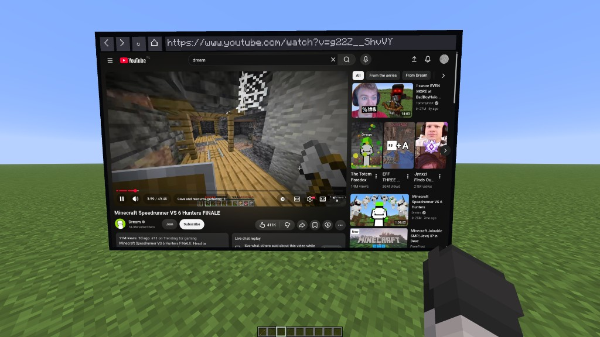
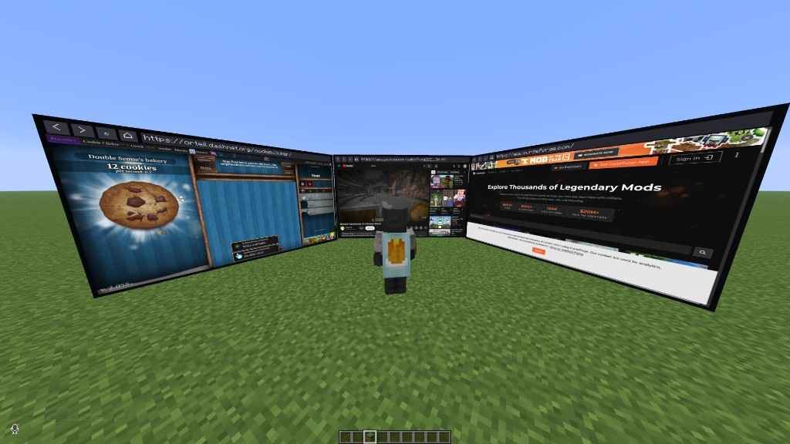
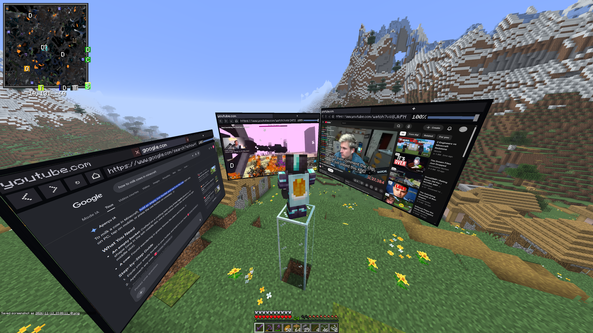
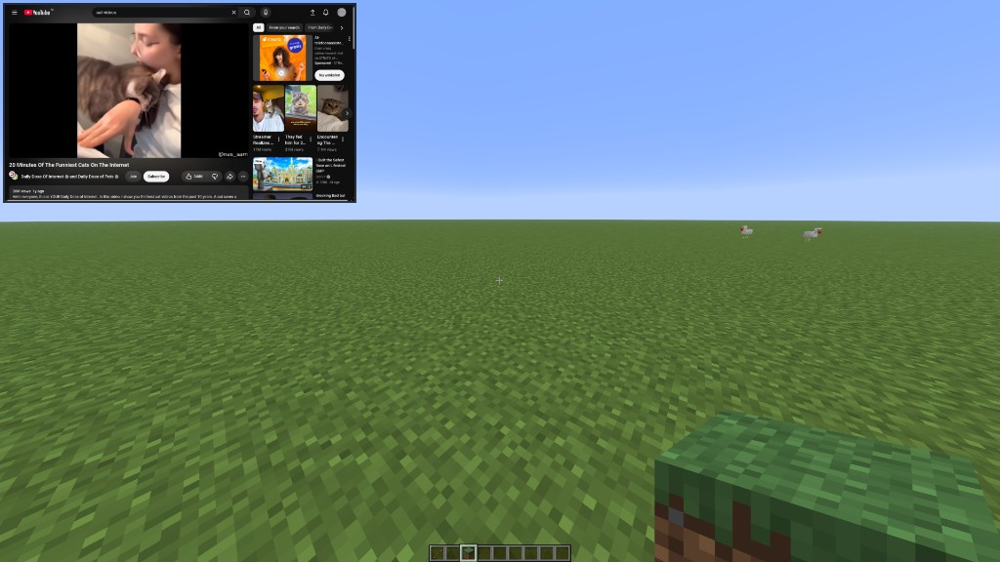

# Screencraft

Watch videos and browse the web inside Minecraft, on screens you place in the world or
in a mini player that follows you while you play.

**Client-side only.** Works on any server, including Paper and Spigot, and nobody else
needs to install anything. Only you can see your screens.

## Screenshots









## Required: MCEF Modern

Screencraft needs **MCEF Modern 0.3.3 or newer**, which provides the Chromium browser.
It is not on CurseForge, so the CurseForge app cannot offer it as an automatic
dependency. Download it here and put it in your `mods` folder next to Screencraft.
If it is missing, Screencraft starts anyway and shows a screen with this link
instead of a loader error:

- [MCEF Modern on Modrinth](https://modrinth.com/mod/mcef-modern) (one-click there)
- [MCEF Modern on GitHub](https://github.com/DimasKama/mcef-modern)

On first launch it downloads Chromium (about 150 MB). The older "MCEF" mod on
CurseForge is a different mod and does **not** work with Screencraft.

You also need **Fabric API**.

## Features

- **Several in-world screens** (3 by default, up to 5 in the settings, more through the
  config file). Hang them on walls, stand them on the floor or let them float in the air.
  Each one has its own browser, so they can all play something different.
- **Any screen shape.** 16:9, 4:3, square, portrait 9:16, ultrawide 21:9, or a custom
  ratio. A portrait screen renders a portrait page instead of a stretched one, and the
  mini player and browser window follow the shape.
- **Server pictures.** A server owner can place images around the world through the
  server resource pack; every player with the mod sees them, and they cannot be moved
  or clicked. Works on Paper and vanilla servers, no plugin needed.
- **Touchscreen controls.** Left-click a screen to click on the page. Right-click it to
  get your mouse cursor and click, drag, scroll and type right on the screen.
- **Address bar on every screen**, plus back, forward, reload and home buttons.
- **Tabs on every screen** (up to 8). Click a tab to switch, **+** to open one, and
  **x** to close it. In control mode, **Ctrl+T** opens a tab, **Ctrl+W** closes it,
  and **Ctrl+Tab** goes to the next.
- **Volume slider on every screen**, and the same control in the panel you get by
  right-clicking a screen (and in the settings list).
- **Camera** for sites that ask for one. Turn it on in the control panel or in Screen
  Settings. It is not a real webcam: the feed is the game itself, with terrain, players,
  mobs, weather and shaders, so video calls and photo sites work with the game as the
  picture. It shows your own view of the world. A camera mounted on the screen is planned
  for a later update; it needed a second render pass that conflicted with Sodium and Iris
  and could crash the game, so it is not in this release.
- **Microphone** for sites that ask for one. Turn it on in the control panel or in
  Screen Settings. It uses your real microphone.
- **Speaker and mic input** in Screen Settings, so you can pick which devices site
  audio and the microphone use.
- **Bring here** is in the control panel and the settings list. It puts that screen in front of you.
- **Full browser window.** `/screencraft` opens a browser with an address bar: type a
  website or anything you want to search.
- **Mini player.** Press **K** to keep the video in a corner of your screen while you
  walk, fight and build. Press **Left Alt** to click and type on it without stopping.
- **Settings menu** with performance profiles (Low, Balanced, High), sharpness
  (720p to 1440p), address bars on or off, screen sizes and keybinds.
- **Your screens are saved** per world and server, and come back when you rejoin.

## How to use

1. Hold a **stick** (you can pick another item in the settings, e.g. if you use
   Litematica) and right-click to start placing a screen. Aim at a wall, floor or
   the air and click again to place it.
2. Click the screen's address bar and type a website or a search, or run **/screencraft**.
3. Press **K** to show the mini player.

| Action | How |
|---|---|
| Move a screen | Aim at it with the stick and right-click |
| Remove a screen | Aim at it with the stick, sneak + right-click |
| Use the mouse and keyboard on a screen | Right-click it (without the stick), ESC to stop |
| Open a tab on a screen | Click **+** on the screen, or Ctrl+T in control mode |
| Close a tab | Click the **x** on that tab, or Ctrl+W in control mode |
| Change a screen's volume | Drag the volume slider on the screen, or the one in the control panel |
| Let a site use your camera | **Camera** in Screen Settings, or **Camera** in the control panel |
| Let a site use your microphone | **Microphone** in Screen Settings, or **Mic** in the control panel |
| Pick the speaker or microphone | **Speaker** and **Mic input** in Screen Settings |
| Bring a screen to you | **Bring here** in the control panel, or **Here** in the settings list |
| Change the placement item | "Placement item" in the settings menu: search any item, modded ones included |
| Place screens without an item | Set "Placement item" to None and use the "Place / move screen" key |
| Change a screen's shape | **Shape** in Screen Settings, or `/screencraft aspect <16:9\|4:3\|1:1\|9:16\|21:9\|W:H>` |
| Settings | `/screencraft settings`, or the Settings button in the browser window |
| Open a page or search | `/screencraft <url or words>` |
| Remove all screens | `/screencraft remove` |
| Click/type on the mini player | **Left Alt** (you can still walk), Left Alt or ESC to go back |

All keys can be changed with the "Keybinds..." button in the settings menu, or in
Options > Controls > Screencraft.

**More than 5 screens:** open `config/screencraft/settings.json`, set `"screenHardLimit"`
to the number you want (up to 64), restart the game, then raise "Max screens" in the
settings menu. Each screen is a full browser, so many screens need a strong PC.

## Server pictures (tutorial)

A server can hang images in the world for every player with the mod. They are inert:
players cannot move, remove or click them, and they are never saved to anyone's config.
No server mod or plugin is needed — the pictures travel in the server's resource pack.

1. Create a pack folder with this layout:

```
screencraft-pack/
├── pack.mcmeta
└── assets/
    └── screencraft/
        ├── server_screens.json
        └── textures/
            └── server/
                └── spawn.png
```

2. `pack.mcmeta` (the format range covers 1.21.10 through 26.3):

```json
{
  "pack": {
    "description": "Server screens",
    "min_format": 64,
    "max_format": 97
  }
}
```

3. Put your picture at `assets/screencraft/textures/server/spawn.png`. Up to 8 MB
   and 8192×8192 pixels per image.

4. Describe the screens in `assets/screencraft/server_screens.json`:

```json
{
  "screens": [
    {
      "image": "server/spawn",
      "dimension": "minecraft:overworld",
      "x": 0.5,
      "y": 66.0,
      "z": 0.5,
      "yaw": 0.0,
      "width": 6.0,
      "aspect": "16:9"
    }
  ]
}
```

`image` is the file name under `textures/server/`. `dimension` defaults to the
overworld. `x`, `y`, `z` are block coordinates. `yaw` is the facing in degrees
(0 = south, 90 = west, 180 = north, 270 = east). `width` is in blocks. `aspect` can
be `16:9`, `4:3`, `1:1`, `9:16`, `21:9`, or a custom ratio like `3:2`.

5. To get the position without guessing: place a normal screen where you want the
   picture, aim at it, and run `/screencraft serverjson`. The command copies an entry
   with the position, facing, size and shape to your clipboard. Paste it into
   `screens`, change `image`, and drop the matching PNG in `textures/server/`.

6. Zip the pack, host it, and point the server at it in `server.properties`:

```properties
resource-pack=https://example.com/screencraft-pack.zip
resource-pack-sha1=<sha1 of the zip>
resource-pack-prompt={"text":"Server screens","color":"gold"}
```

7. Players can hide the server's pictures at any time with `/screencraft server off`,
   or the **Server screens** toggle in Screen Settings.

Up to 64 screens per pack. Images only (no web pages), for obvious reasons. A complete
ready-to-edit pack, plus the full guide, is here:
[Example pack and guide](https://github.com/Mateooo93/screencraft/tree/main/docs/server-screens).

## Performance

Each screen is a real browser. Screens you are not looking at slow down automatically,
and the **Balanced** profile (default) keeps several screens smooth. Pick **High** in the
settings for full 60 fps everywhere and the best video quality on a strong PC, or **Low**
on a weaker one.

## Notes

- Works on Minecraft 1.21.10, 1.21.11, 26.1, 26.1.1, 26.1.2, 26.2 and 26.3. On CurseForge there is a separate
  download for each (including one file per 26.1 patch). Use the MCEF Modern file made for
  the same Minecraft version.
- On 26.3 with the Vulkan renderer, far-away screens are a little less smooth-looking
  than with OpenGL.
- Screencraft is not affiliated with or endorsed by Google or YouTube.
